<!-- ═══════════════════════════════════════════════════════════ -->
<!--           ALEVERIO · PROFILE README · v4 🦀 LIVE            -->
<!-- ═══════════════════════════════════════════════════════════ -->

<div align="center">

<!-- Custom banner (asset di repo, bukan layanan luar) -->
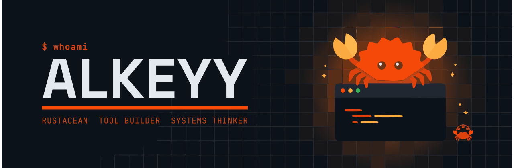

<!-- Typing -->
<a href="https://github.com/Aleverio">
  
</a>

<br/>

<!-- Live badges — angka di sini di-fetch ulang setiap halaman dibuka -->
<a href="https://www.rust-lang.org/"></a>
<a href="https://github.com/Aleverio?tab=followers"></a>
<a href="https://github.com/Aleverio?tab=repositories"></a>
<a href="https://github.com/Aleverio?tab=repositories"></a>


</div>

---

##  About Me

```console
$ neofetch
        _~^~^~_          alkeyy@github
    \) /  o o  \ (/      ──────────────────────────────────────────
      '_   -   _'        Role     : Systems & Tooling Developer
      / '-----' \        Main     : Rust 🦀
                         Explored : C++ · JS · Python · HTML · CSS · Lua
                         Building : ICode-Editor · nova-studio
                         Focus    : rendering · wgpu · native performance
                         Motto    : "If it can be built, I'll build it myself."
                         Curiosity: [██████████] u32::MAX

$ cargo run --release --bin alkeyy
   Compiling alkeyy v0.1.0 (/home/alkeyy/projects)
    Finished `release` profile [optimized] in 0.42s
     Running `target/release/alkeyy`

> mission  : turn ideas into tools people actually use
> warnings : 0 errors, 0 warnings ✨
```

---

##  Daily Fuel

<div align="center">

<!-- Kata-kata pengubah hidup — berganti otomatis setiap hari via Actions -->

</div>

<details>
<summary>🥚 <b>secret stash — click if you dare</b></summary>

<br/>

```console
$ cargo build --release --features motivation
   Compiling motivation v1.0.0
    Finished `release` profile [optimized] in 0.00s
     Running `target/release/motivation`

> "The best way to predict the future is to compile it." 🦀
> hint: there are zero unsafe blocks in this profile. and in my dreams.
```

</details>

---

##  Arsenal

<div align="center">

**Daily driver**


**Languages I've wielded**


**Toolchain**


</div>

---

##  Live Analytics

<div align="center">

<!-- Cards ini di-generate dari GitHub API asli oleh Actions tiap 6 jam -->

<br/>

<!-- Streak & graph di-fetch live setiap halaman dibuka -->


<br/>

<a href="https://github.com/Aleverio/Aleverio/actions/workflows/stats.yml"></a>


<br/>

<sub>📡 Cards: real GitHub API data, regenerated by Actions every 5m · Badges, streak & graph: fetched live on every page view</sub>

</div>

---

##  Contribution Pulse

<div align="center">

<!-- Heatmap kontribusi + aktivitas commit — di-generate dari data GitHub asli -->
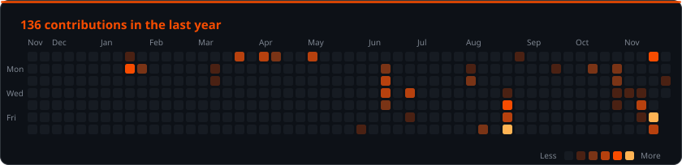

<sub>📡 full-year calendar via GitHub GraphQL in Actions · commit activity from live public events</sub>

</div>

---

##  Open Source

<!-- Tabel ini di-generate otomatis dari GitHub API oleh Actions — repo asli, bukan pajangan -->
<!-- REPOS:START -->
<div align="center">

<a href="https://github.com/Aleverio/nova-studio"></a> <a href="https://github.com/Aleverio/Porject-CodeBase"></a>

<a href="https://github.com/Aleverio/ICode-Editor"></a> <a href="https://github.com/Aleverio/Winc"></a>

<a href="https://github.com/Aleverio/BenBot"></a>

<sub>📡 every public repo, straight from the GitHub API · last sync 2026-11-20 14:48 UTC</sub>

</div>
<!-- REPOS:END -->

<!-- ═══════════════════════════════════════════════════════════
🎮 BONUS: Pacman & Snake eat your contribution graph!
1. Workflow sudah ada di .github/workflows/snake.yml
2. Buka tab Actions → "Generate Snake Animation" → Run workflow
3. Uncomment blok di bawah ini, commit. Done!
════════════════════════════════════════════════════════════

<picture>
  <source media="(prefers-color-scheme: dark)" srcset="https://raw.githubusercontent.com/Aleverio/Aleverio/output/pacman-contribution-graph-dark.svg" />
  <source media="(prefers-color-scheme: light)" srcset="https://raw.githubusercontent.com/Aleverio/Aleverio/output/pacman-contribution-graph.svg" />
  
</picture>

<picture>
  <source media="(prefers-color-scheme: dark)" srcset="https://raw.githubusercontent.com/Aleverio/Aleverio/output/github-contribution-grid-snake-dark.svg" />
  <source media="(prefers-color-scheme: light)" srcset="https://raw.githubusercontent.com/Aleverio/Aleverio/output/github-contribution-grid-snake.svg" />
  
</picture>

═══════════════════════════════════════════════════════════ -->

---

<div align="center">

<a href="https://github.com/Aleverio"></a>
<a href="https://www.rust-lang.org/learn"></a>

<br/><br/>

```console
$ exit
logout
Connection to github.com closed.
...see you in the next commit 🦀
```


<sub>🦀 Compiled with passion by <b>Alkeyy</b> — zero unsafe, infinite curiosity.</sub>

</div>
